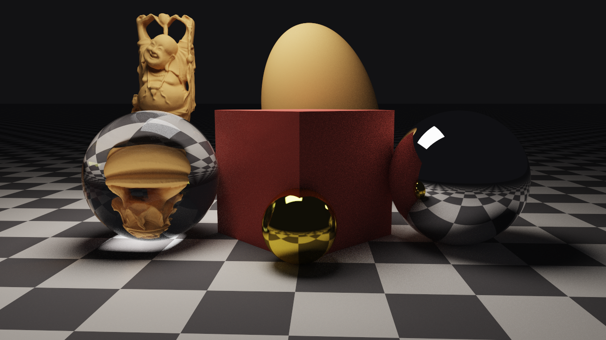
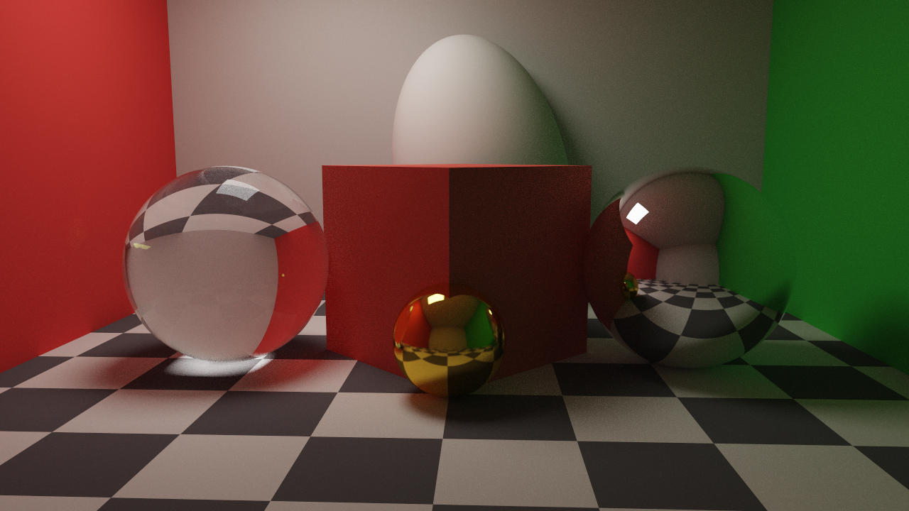
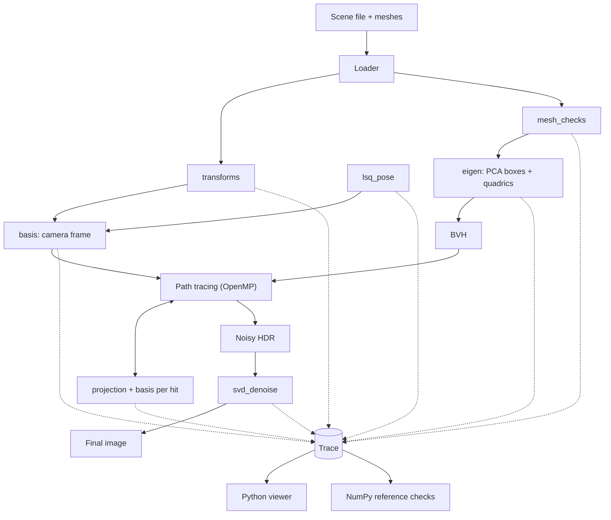

# Path Tracer

[](https://github.com/LonelyGuy-SE1/path-tracer/actions/workflows/ci.yml)
[](LICENSE)
[](https://isocpp.org/)
[](https://www.python.org/)
[](https://eigen.tuxfamily.org/)
[](https://www.openmp.org/)

A Monte Carlo path tracer built from linear algebra modules — orthonormal frames, projections, eigen decompositions, and SVD — wired into a config-driven C++ render pipeline with Python inspection and NumPy reference checks.

<p align="center">
  
  <br/>
  <em>Final demo — glass, metal, diffuse materials, softbox lighting, and caustics (1280×720 @ 800 spp)</em>
</p>

<p align="center">
  
  <br/>
  <em>Cornell-style box — color bleeding, reflections, refraction, and soft shadows</em>
</p>

---

## Features

- **Path tracing** with next-event estimation, Russian roulette, and OpenMP
- **Materials** — diffuse, metal, glass, checker, emissive area lights
- **Geometry** — triangle meshes (BVH), spheres, ellipsoids, planes, quads
- **Linear-algebra stages** — Gram–Schmidt bases, projections, mesh rank checks, eigen PCA / quadrics, SVD denoising
- **Config-driven pipeline** — resolution, spp, stages, exposure, and SVD rank from one JSON file
- **Trace + Python viewer** — inspect matrices and validate stages against NumPy

## Quick start

```bash
# Build + render (reads config.json)
./run.sh

# Or point at another config
./run.sh config.ci.json   # fast / low-res smoke
```

Requirements: CMake, a C++17 compiler, OpenMP, Python 3.10+.

```bash
cmake -S . -B build -DCMAKE_BUILD_TYPE=Release
cmake --build build -j"$(nproc)"
ctest --test-dir build --output-on-failure
```

Default quality knobs live in [`config.json`](config.json) (currently **1280×720**, **800 spp**). CI uses [`config.ci.json`](config.ci.json).

## How it works

A scene JSON describes meshes, quadrics, materials, lights, and a camera. The loader turns geometry into matrices (vertices as columns of a \(4 \times N\) matrix; every object and the camera gets a \(4 \times 4\) transform).

| Stage | Linear algebra | Role in the renderer |
| --- | --- | --- |
| `transforms` | Orthogonal matrices | Object / camera transforms; \(Q^\top Q = I\), \(\det\) checks |
| `basis` | Gram–Schmidt | Camera frame and local frames at each hit for bounce sampling |
| `projection` | Orthogonal projection | Reflection, shading, shadows, image plane |
| `mesh_checks` | Rank / independence | Drop degenerate triangles and redundant vertices |
| `eigen` | Symmetric eigen | PCA bounding boxes, ellipsoid intersection |
| `lsq_pose` | Least squares | Pose from noisy 2D↔3D correspondences |
| `svd_denoise` | Truncated SVD | Low-rank denoising of the Monte Carlo image |



Light transport is Monte Carlo path tracing with area-light NEE and Russian roulette. The raw HDR is optionally cleaned with a truncated SVD per color channel.

## Layout

```
core/       rays, shapes, BVH, materials, path tracer, scene loader
stages/     one Eigen-only module per linear-algebra stage
trace/      C++ writer + Python reader
viewer/     inspection, plots, comparisons
prep/       mesh_checks + eigen preprocessing
tests/      C++ + NumPy stage tests
scenes/     scene JSON + meshes
docs/       stage notes, math pipeline, gallery
```

## Docs

| Doc | What it covers |
| --- | --- |
| [`docs/MATH_PIPELINE.md`](docs/MATH_PIPELINE.md) | End-to-end math walkthrough |
| [`docs/CONVENTIONS.md`](docs/CONVENTIONS.md) | Coordinates, types, naming |
| [`docs/TRACE_SPEC.md`](docs/TRACE_SPEC.md) | Trace schema |
| [`docs/prep.md`](docs/prep.md) | Python prep pipeline |
| [`docs/gallery/`](docs/gallery/) | Sample renders |

## Conventions

Column vectors, right-handed coordinates, Y-up. Doubles inside stages, floats in the render loop. Stage entry points are named `stage_<name>`. Full conventions: [`docs/CONVENTIONS.md`](docs/CONVENTIONS.md).

## License

[GPL-3.0](LICENSE)
